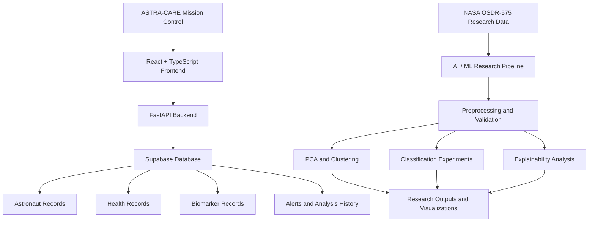

&#x20;\<div align="center">

\

# ASTRA-CARE

### Advanced Spaceflight Tracking, Research & Astronaut Care Ecosystem

**Intelligent Astronaut Health Monitoring and Research Platform**

*Beyond Earth. Beyond Connectivity. Beyond Limits.*


\


**[Explore Repository](https://github.com/bhattacharyyapratanu1/ASTRA-CARE-NASA-SPACE-APPS-2026) · [Project Documentation](SUBMISSION_GUIDE.md) · Demo Video — Coming Soon**

\</div>

---

## 01. Mission Overview

Space exploration pushes human physiology beyond its normal boundaries. Microgravity, radiation exposure, isolation and demanding mission conditions create complex challenges for astronaut health monitoring.

**ASTRA-CARE** is a research and demonstration platform designed to support astronaut health monitoring through an integrated digital environment combining health records, biomarker information, analytical research, alerts and interactive 3D visualization.

The platform brings together NASA-related space health research, machine learning experimentation and a modern mission-control interface to explore how astronaut health information can be organized, visualized and investigated.

Our objective is to make complex health information more accessible, structured and understandable for future space-health research.

## 02. Core Capabilities

\<table>
\<tr>
\<td width="50%">

### Mission Control Dashboard

- Centralized astronaut overview
- Mission status and system information
- Health-record statistics
- Biomarker and alert summaries
- Database-driven dashboard metrics

\</td>
\<td width="50%">

### Astronaut Digital Twin

- Interactive 3D space environment
- Illustrative anatomical visualization
- Astronaut-focused information screens
- Mission-oriented user interface

\</td>
\</tr>
\<tr>
\<td width="50%">

### Biomarker Intelligence

- Biomarker record management
- Measurement visualization
- Unit-aware charting
- Historical record exploration
- Research-oriented biomarker analysis

\</td>
\<td width="50%">

### Health Record Management

- Astronaut health-record storage
- Heart-rate information
- SpO2 measurements
- Body-temperature records
- Historical health information

\</td>
\</tr>
\<tr>
\<td width="50%">

### Alert Management

- Alert creation and tracking
- Severity classification
- Active-alert monitoring
- Alert resolution
- Centralized alert records

\</td> \<td width="50%">

### AI & ML Research

- Data preprocessing and validation
- Principal Component Analysis
- K-Means clustering
- Classification experiments
- Explainable AI research
- Biomarker importance analysis

\</td>
\</tr>
\</table>

## 03. System Architecture

ASTRA-CARE follows a modular architecture connecting an interactive frontend, a FastAPI backend, a Supabase database and a separate machine learning research workflow.



### Technology Stack

| Layer            | Technologies                      |
| ---------------- | --------------------------------- |
| Frontend         | React 19, TypeScript, Vite        |
| Styling          | Tailwind CSS, CSS                 |
| 3D Visualization | Three.js, React Three Fiber, Drei |
| Animation        | Framer Motion, GSAP               |
| Charts           | Recharts                          |
| API              | Python, FastAPI, Pydantic         |
| Database         | Supabase                          |
| Machine Learning | Scikit-learn, NumPy, Pandas       |
| Data Processing  | Python, Jupyter Notebook          |
| Version Control  | Git, GitHub                       |

## 04. AI & Machine Learning Research

The AI/ML research component explores patterns in astronaut-related biomarker datasets using NASA OSDR-575 / Inspiration4 research data.

The research workflow includes:

1. **Dataset Integration:** Organizing and validating research datasets.
2. **Data Preprocessing:** Missing-value analysis, median imputation and feature preparation.
3. **Dimensionality Reduction:** Applying Principal Component Analysis (PCA) to explore feature relationships.
4. **Unsupervised Learning:** Using K-Means clustering to investigate participant and biomarker patterns.
5. **Classification Experiments:** Exploring classification approaches and comparing model performance.
6. **Model Stability:** Examining participant-level stability.
7. **Explainable AI:** Investigating feature importance using permutation-based analysis.
8. **Research Validation:** Generating audit reports, comparison tables and visualization outputs.

### Research Models and Methods

| Method                 | Research Purpose           |
| ---------------------- | -------------------------- |
| Median Imputation      | Missing-value handling     |
| StandardScaler         | Feature standardization    |
| Log1p Transformation   | Feature preprocessing      |
| K-Means                | Unsupervised clustering    |
| PCA                    | Dimensionality reduction   |
| Classification Models  | Exploratory classification |
| Permutation Importance | Model explainability       |

### Scientific Considerations

The research component is exploratory rather than clinically validated.

- The available research involved four independent participants.
- Repeated measurements must not be treated as independent participants.
- Classification and explainability results are exploratory.
- Cluster assignments do not represent medical diagnoses.
- Model outputs are not validated clinical risk probabilities.
- Research datasets are not interchangeable with live astronaut health records.

**Prediction safety:** The current backend deliberately disables live predictions from existing biomarker records until sample identity, measurement units and source provenance can be verified. This is an intentional data-integrity safeguard.

## 05. Repository Structure

The repository is organized into seven major sections to keep research, development, documentation and presentation materials separate.

```text
ASTRA-CARE/
│
├── 01 – Project Planning/
│   └── Planning and project organization
│
├── 02 – Research & NASA Data/
│   └── NASA research and dataset documentation
│
├── 03 – AI & ML/
│   ├── data/
│   ├── models/
│   ├── outputs/
│   ├── ASTRA_CARE_AIML.ipynb
│   └── README.md
│
├── 04 – Frontend/
│   ├── public/
│   ├── src/
│   │   ├── assets/
│   │   ├── components/
│   │   ├── pages/
│   │   ├── services/
│   │   └── hooks/
│   ├── package.json
│   └── vite.config.ts
│
├── 05 – Backend/
│   ├── ai_models/
│   ├── tests/
│   ├── main.py
│   ├── database.py
│   └── supabase_client.py
│
├── 06 – Summary/
│   └── Project reports and documentation
│
├── 07 – Presentation/
│   └── Project presentation
│
├── .gitignore
├── LICENSE
├── SUBMISSION_GUIDE.md
└── README.md
```

## 06. Backend API

The FastAPI backend provides structured endpoints for managing astronaut information and associated health data.

| Module               | Endpoint                       | Operations                             |
| -------------------- | ------------------------------ | -------------------------------------- |
| Health Check         | `/health`                      | GET                                    |
| Dashboard            | `/api/dashboard`               | GET                                    |
| Astronauts           | `/api/astronauts`              | GET, POST                              |
| Individual Astronaut | `/api/astronauts/{id}`         | GET                                    |
| Health Records       | `/api/health-records`          | GET, POST                              |
| Biomarkers           | `/api/biomarkers`              | GET, POST                              |
| Alerts               | `/api/alerts`                  | GET, POST                              |
| Resolve Alert        | `/api/alerts/{id}/resolve`     | PATCH                                  |
| Analysis History     | `/api/analysis/{astronaut_id}` | GET                                    |
| Save Analysis        | `/api/analysis`                | POST                                   |
| Analysis Inference   | `/api/analysis/predict`        | POST, subject to provenance safeguards |

Interactive API documentation is available through FastAPI Swagger UI when the backend is running:

`http://127.0.0.1:8000/docs`

## 07. Getting Started

### Prerequisites

- Python 3.10 or compatible version
- Node.js and npm
- Git
- Supabase project and database credentials

### Clone the Repository

```bash
git clone https://github.com/bhattacharyyapratanu1/ASTRA-CARE-NASA-SPACE-APPS-2026.git
```

```bash
cd ASTRA-CARE-NASA-SPACE-APPS-2026
```

### Start the Frontend

```bash
cd "04 – Frontend"
npm install
npm run dev
```

Open the local Vite URL displayed in your terminal, normally:

`http://localhost:5173`

### Start the Backend

Open another terminal from the project root:

```powershell
cd "05 – Backend"
```

Configure your local Python environment and install the backend dependencies as described in the [Submission Guide](SUBMISSION_GUIDE.md).

Configure the required Supabase credentials in a private `05 – Backend/.env` file. Never commit credentials to GitHub.

Start the API:

```powershell
uvicorn main:app --reload --host 127.0.0.1 --port 8000
```

The frontend development server uses the configured Vite proxy to communicate with the backend.

For complete environment configuration, validation commands and production-style local execution, see [SUBMISSION_GUIDE.md](SUBMISSION_GUIDE.md).

## 08. Screenshots & Visual Experience

The project includes an interactive 3D environment, digital-twin components, biomarker visualizations and mission-control screens.

The frontend assets and components are available in:

[`04 – Frontend/src`](04%20%E2%80%93%20Frontend/src)

Additional research charts, PCA visualizations, clustering comparisons and explainability outputs are available in:

[`03 – AI & ML/outputs`](03%20%E2%80%93%20AI%20%26%20ML/outputs)

## 09. Demo Video

The project demonstration video will be added here separately.

\<!-- Add the GitHub-hosted demo video attachment link here when available. -->

## 10. Future Scope

ASTRA-CARE provides a foundation for further research and development in astronaut health monitoring.

Potential future directions include:

- Stronger integration of verified astronaut health datasets.
- Reliable sample-level biomarker provenance.
- Improved longitudinal health analysis.
- Enhanced digital-twin visualization.
- Additional research into astronaut physiological patterns.
- Secure integration of validated health-monitoring workflows.
- Expanded monitoring and reporting capabilities for long-duration missions.

## 11. Disclaimer

ASTRA-CARE is a research and demonstration project developed for the NASA Space Apps Challenge 2026.

It is not a certified medical device, diagnostic system or replacement for professional medical evaluation. The 3D anatomical visualization is illustrative, and experimental machine learning results must not be interpreted as clinical findings.

NASA and its associated organizations are not implied to endorse this project.

## 12. Acknowledgements

We acknowledge:

- NASA Open Science Data Repository (OSDR) for making research datasets accessible.
- The Inspiration4 research community and associated scientific contributors.
- The NASA Space Apps Challenge for providing a platform for collaborative innovation.
- The open-source developer community behind the technologies used in this project.

## 13. License

This project is distributed under the license included in the repository. See [LICENSE](LICENSE) for details.

---

\<div align="center">

### ASTRA-CARE

**Engineering a healthier future for human space exploration.**

*Beyond Earth. Beyond Connectivity.*

[Repository](https://github.com/bhattacharyyapratanu1/ASTRA-CARE-NASA-SPACE-APPS-2026) · [NASA Space Apps Challenge](https://www.spaceappschallenge.org/)

\</div>
